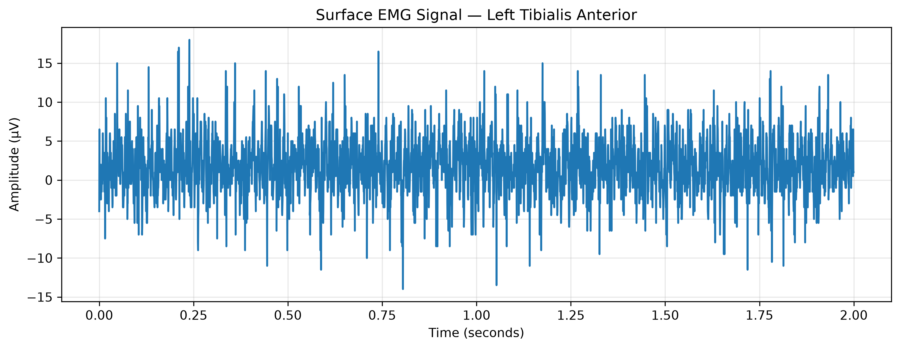
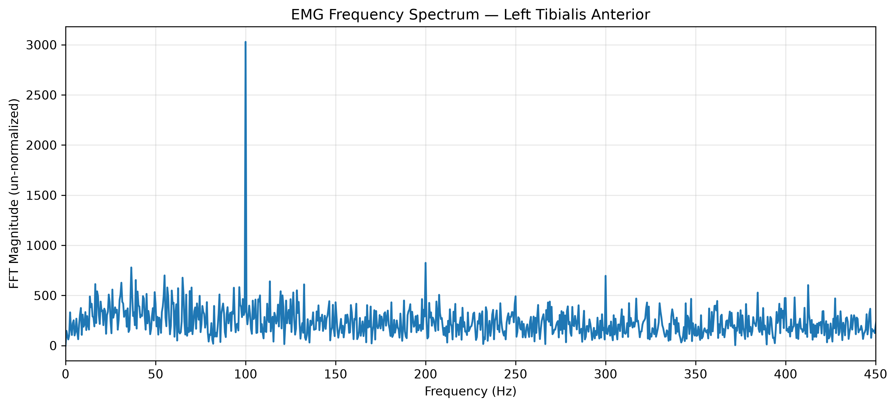
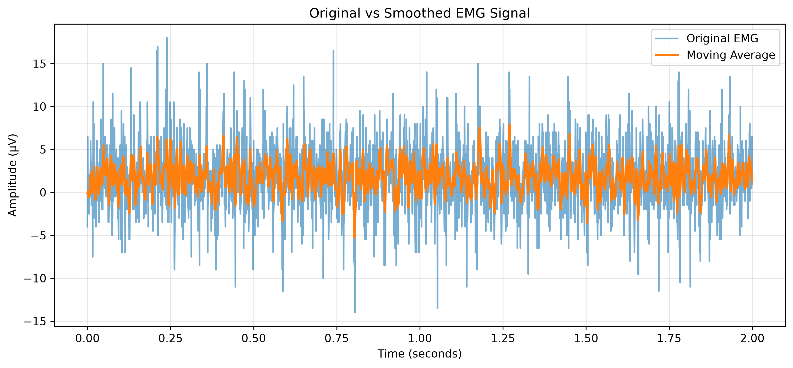

# EMG Signal Detective
### Exploring Muscle Signals with Python

## About the Project

I'm interested in the intersection of electrical engineering and biomedical engineering, particularly how electrical signals produced by muscles can be recorded, analyzed, and interpreted.

I started this project to explore surface electromyography (sEMG) signals using Python and real-world biomedical data. It also gave me an opportunity to apply my programming skills to something beyond coursework while learning more about signal analysis and processing.

## Project Objectives

- Explore publicly available surface EMG recordings.
- Visualize and examine muscle signal characteristics.
- Calculate amplitude measurements using MAV and RMS.
- Investigate frequency components using Fourier analysis.
- Apply basic signal processing techniques and compare their effects.
- Explore how signal analysis relates to applications such as myoelectric prosthetics.

## Dataset

This project uses the [Surface Electromyographic Signals During Walking dataset](https://physionet.org/content/semg/1.0.1/) from PhysioNet.

The analysis focuses on:
- **Recording:** S01
- **Muscle:** Left tibialis anterior
- **Channel:** `semg LT TIB.A`
- **Activity:** Walking
- **Segment:** First 2 seconds
- **Sampling rate:** 2,000 Hz

The original dataset is accessed directly through the WFDB Python library. See [`data/README.md`](data/README.md) for dataset information.

## Tools and Technologies

- Python
- Jupyter Notebook
- NumPy
- Matplotlib
- WFDB

## Analysis

The project explores several stages of EMG signal analysis:

1. **Signal Visualization:** Examining the waveform over time and identifying notable peaks.
2. **Amplitude Analysis:** Calculating Mean Absolute Value (MAV) and Root Mean Square (RMS).
3. **Frequency Analysis:** Using the Fast Fourier Transform (FFT) to examine frequency components.
4. **Signal Processing:** Applying a moving average filter to smooth the waveform.
5. **Results Comparison:** Evaluating changes in amplitude measurements and frequency characteristics before and after processing.

## Key Findings

Applying a 10-sample moving average filter produced the following changes:

**Original Signal**
- MAV: 2.9799 μV
- RMS: 3.8392 μV

**Processed Signal**
- MAV: 2.0496 μV
- RMS: 2.4841 μV

The moving average reduced MAV by approximately 31.2% and RMS by approximately 35.3%.

Frequency analysis also showed attenuation across much of the analyzed frequency range. These results demonstrate how signal processing can alter both the amplitude and frequency characteristics of an EMG recording.

The analysis also highlights the importance of distinguishing unwanted interference from meaningful physiological activity.

## Visual Results

### Original EMG Signal

### Frequency Spectrum

### Original vs. Processed Signal

[View all project figures](figures/)

## Repository Structure

EMG-Signal-Detective/
│
├── data/
│   └── README.md
│
├── figures/
│   └── [Analysis figures]
│
├── notebooks/
│   ├── 01_emg_signal_analysis.ipynb
│   └── Practice_runs.ipynb
│
├── reports/
│   └── results_summary.md
│
└── README.md

## Running the Project

Install the required Python libraries:

pip install numpy matplotlib wfdb

Open `notebooks/01_emg_signal_analysis.ipynb` in Jupyter Notebook and run the cells in order.

An internet connection is required to retrieve the recording directly from PhysioNet.

## Limitations

This is an exploratory signal analysis project based on a short, 2-second segment from one muscle channel.

The original dataset signal was already hardware-filtered during acquisition. The moving average filter may also suppress meaningful muscle activity alongside unwanted fluctuations.

The analysis does not establish that noise was successfully removed or that the processed signal is more accurate.

## Project Status

The initial signal analysis and processing investigation is complete. Notebook validation, documentation, and repository polishing are ongoing.

## Learning Takeaways

This project provided an opportunity to explore biomedical signals through programming and basic electrical signal analysis. It helped develop practical experience with data handling, signal visualization, frequency analysis, and signal processing while connecting concepts from electrical engineering with biomedical applications.
